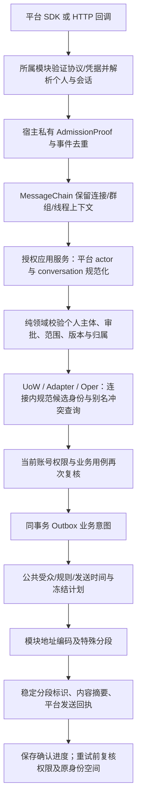

# 通用核心与平台实现边界

导航：[设计](design.md) · [计划](plan.md) · [任务](tasks.md) · [验证](validation.md)

## 来源核对

对照官方目标 `fda8d5cbb340e32020ebfd2e61c7ff96347a7fe3` 与本轮起点 `84f2d8038e040efd775298e7cb3346d10c416238` 的实际代码、调用者和 PR 差异。

| 调整前位置 | 来源与实际职责问题 | 调整后 owner |
| --- | --- | --- |
| `domain/authorization.py:channel_actor_ids` | QQ/VoceChat 前缀解释在官方基线已存在，非本次 PR 新增；领域混入平台个人/群组协议 | 模块 `channel.py:actor` 产生规范事实，领域只验证 `ChannelActor.kind` 和标识 |
| `db/oper/authorization.py:find` | 本次 PR 新增逐行解析入参，查询行为依赖数据库行的平台值 | 应用入口解析一次；仓储接收候选身份元组，限定连接并拒绝多匹配 |
| 通用 `InteractionPolicy.command_guild_id` | 本次新增 Discord 命令注册字段泄漏到公共结构与共享前端 | `platform_options`；Discord 拥有校验、运行态投影及旧字段兼容，独立表单扩展 |
| `channel/rules.py` | 本次新增平台地址正则、前缀编码、默认收件人解释 | 模块目标能力、`validate_target`、`bound_address`、`address_message`；公共层只处理规则/受众/时间/去重 |
| `channel/catalog.py`、`settings.py` | 本次新增平台能力、模式、凭据和可编辑字段分支 | 模块扩展；应用保留 revision、事务、同账号轮换比较、脱敏投影编排 |
| `startup/initializers/modules.py` | 本次新增平台诊断与 ClawBot 缓存实现 | 模块 `probe_identity`、`reconcile`、`manage`；启动层仅分组与受管线程生命周期 |
| `messaging/attachment.py` | 本次新增 Slack 原图/按钮特殊分段 | Slack `split_notification`；公共组合层随后分配稳定分段序号 |
| `chain/message.py` | 本次新增对所有平台统一去 `group:`；附件 URI 分派大部分为上游既有，逐调用核对后一起收敛 | 平台 `conversation` 和 `attachment_reference`；Chain 执行既有模块下载 ABI 与通用 HTTP/data 编码 |
| 共享设置/规则弹窗 | 本次新增固定平台列表与 Discord/Slack/VoceChat 等判断 | 后端 `providers`/`capabilities`、平台连接表单、按扩展键加载的交互组件 |

不把平台名出现在说明、分享格式中的 provider 比较、正式升级快照或合法注册代码判定为违规。平台扩展是事实来源，不能批准成员、提升角色或决定业务数据所有者。

## 公共契约与注册

复用既有 `CapabilityRegistry` 与各模块 `capability.toml`：`metadata.channel_extension` 指向本模块 `channel:<Class>`，`channel_interaction` 只声明机器人入口。清单校验拒绝跨模块实现、非法扩展和非布尔声明。`ModuleChannelCatalog` 是同一注册表的只读投影，不维护另一套模块激活状态。目录在首次使用时装配并缓存纯清单，不持有凭据、客户端或成员权限。

应用端口位于 `app/application/messaging/channel/platform.py`，包根仅为精确懒门面，模块的无状态模板位于 `app/modules/_base/channel.py`；模板没有平台名称或协议分支。新增平台只在模块目录提供实现、清单和必要的专属表单。规范身份模型和仓储查询不随平台变化。`MessageAttachmentRead` 描述既有模块方法和参数，不增加第二种调度器；旧 `download_*` 方法与插件接口保留。

## 完整调用链

身份的其他入口：管理员手工录入 → 授权服务 → 平台 actor → 领域个人校验 → 同一 UoW；账号关联 → 已验证私聊及一次性关联码 → 同一规范化申请入口 → 事务核对双方不可变账号身份；历史成员读取 → 规范候选身份查询 → 应用复核所读主体 → 当前权限核对。历史配置中的用户/群组规则在应用边界规范化；认证证明仅转换身份表示，不修改其连接、策略版本、私聊事实或有效期。拒绝/停用优先，平台能力不会授予搜索、下载或定时任务权限。

设置链：HTTP DTO → `ChannelSettingsService` → 模块专属字段校验 + 公共能力/受众约束 → 配置事务中 revision 比较 → 保存规范快照 → 发布配置失效 → 启动层编排重读/缓存对账。凭据诊断在事务外执行，但提交时再次比较连接 revision 与平台账号；无法确认身份暂停连接，其他账号的凭据拒绝安装。

通知链：已确定的宿主受众 → 公共规则和全局/规则时间交集 → 模块验证/编码目标 → 通用图文与文件组合 → 模块特殊分段 → 公共稳定编号 → Outbox 冻结连接/目标/规则/分段摘要 → 实际发送与确认。已确认段不重发，unknown 不盲目补发；新目标、跨线程、跨身份空间和未发送段内容变化仍拒绝。分段迁移不改变旧布局、序号偏移或摘要构造。

附件入站：模块声明的唯一 scheme owner 解释显式 URI（保留原混合附件/插件行为）；无显式平台 scheme 时由当前渠道扩展解释引用 → `MessageAttachmentRead` → Chain 调用既有 `run_module` 下载方法并注入原 source → 通用 bytes/data URL 转换与 Agent/STT。模块拥有 scheme 与引用格式，公共代码只按 URI scheme 查找唯一 owner，复用原 source 及既有模块下载边界；HTTP 与 data 通用路径仍使用原宿主网络策略。文本确认能力仅决定平台是否支持入口，Agent 会话匹配与授权仍独立执行。

## 升级、数据与公开兼容

`62c91ad8b057` 使用 `database/legacy/channel_resources_v1.py` 和最小固定 schema 的离线导入，不依赖应用配置服务、模块目录、可变 SDK 或平台网络。群地址隔离继续使用迁移内冻结格式。迁移 revision 不变，不要求已升级数据库重打标。运行时旧配置导入仍调用模块扩展；回归逐平台核对其最终结果与固定迁移一致。

规范交互策略只持久化 `platform_options`。Discord 读取旧 flat `command_guild_id`，公开读取仍附带该兼容字段，旧 PUT 输入由 Discord 模块规范化并验证；其他渠道不能借此设置 Discord 选项。旧记录中的空兼容字段可被读取，但未知的非空设置仍拒绝。未注册插件保持旧通知投影，不因缺少实现得到机器人或免审批能力。

账号名称可重用，连接身份空间、成员随机 ID 和不可变账号归属不可重用。别名冲突拒绝合并，群组不能成为个人，撤权、账号删除重建及轮换仍在执行和发送边界复核。凭据不出现在 `capabilities`、表单回填和兼容公开投影中。

## 可执行约束与验收

`python scripts/architecture/channel_platforms.py` 已接入架构 CI。检查通用授权、仓储、渠道应用包、消息结构、附件组合、Chain 与启动层中的具体模块导入、协议常量、凭据键、平台枚举分派及 provider 字面量分支；没有写基线模式。允许实现边界是 `app/modules/<provider>/channel.py`、既有模块客户端、模块清单与注册适配器、组合根的装配入口，以及 `database/legacy`/迁移的固定离线算法。允许边界不能成为公共用例或权限逻辑的替身。

`test_channel_platform_extensions.py` 提供合成渠道，经既有注册表加载，证明规范身份、历史别名、群组拒绝、跨连接、冲突拒绝、规则能力、设置投影与自定义线程均无需修改核心。它还覆盖固定离线升级对照、原模块附件 ABI、Slack 冻结分段和确认后恢复。既有回归继续覆盖账号关联、撤权、跨群组/线程、凭据轮换和同名重建。真实企业微信验收本轮明确跳过。
